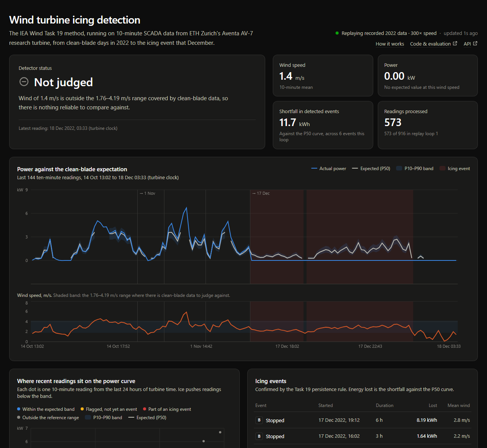
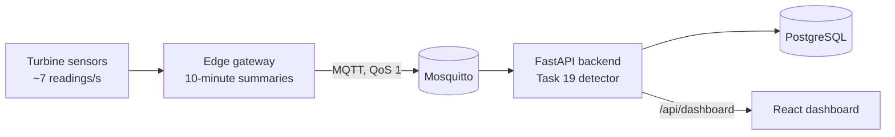

# Wind Turbine Icing Detection

[](https://github.com/dcmclarke/wind-turbine-twin/actions/workflows/ci.yml)

Flags likely ice on a wind turbine's blades from the turbine's own SCADA data,
using the IEA Wind Task 19 method, and runs it as an IoT pipeline: edge
gateway → MQTT → FastAPI → PostgreSQL → React dashboard. It is built on real
data from ETH Zurich's Aventa AV-7 research turbine, which iced up in
December 2022.

**[Live demo](https://wind-turbine-icing.netlify.app)**. It replays the 2022
recordings at 300× speed. Free hosting sleeps when idle, so the first load
takes up to a minute.



## Results

Evaluated on 11 clean-blade days and the 17–20 December 2022 icing period.
Each clean day was scored against a reference curve fitted without that day.
The comparison is a rule that raises an alarm whenever a 10-minute reading
shows zero output while the wind is above cut-in. Both are scored on the same
190 clean readings: those inside the reference curve's wind range, the only
ones the detector judges. (On every clean reading above cut-in, the rule
raises 12 false events.)

|                                        | Task 19 detector              | Zero-output rule          |
| :------------------------------------- | :---------------------------- | :------------------------ |
| Finds the December icing event         | Yes, 60 min after it begins   | Yes, 10 min after         |
| False events on 11 clean days          | **6, all on one day**         | 10, spread over 5 days    |
| Clean days with no false event         | **7 of 8**                    | 3 of 8                    |
| Energy lost during the icing event     | 12.7 kWh against expected     | not estimated             |

Three clean days had no readings in the reference range, so the clean-day
row counts the eight days that had any. The hour's delay is by design: Task 19 wants an hour of evidence before it
calls a stop. The six false events all fell on 20 June 2022, when the turbine
ran at about 70% of its expected output all day. That was a real shortfall,
and the data doesn't say what caused it. It was June, so a working
temperature sensor would have ruled out ice.

<p>
  
  
</p>

**What this does not show.**

- **One icing event.** The public data holds a single icing event, too few to claim a detection rate.
- **Only the "stopped" case has met real ice.** The turbine was stopped for the whole event, so the "stopped" class (B) has been tested against real ice. The "reduced output" class (A) and the "overproduction" class (C) have only been tested for false alarms.
- **No temperature data.** The turbine's temperature sensor was broken for the entire dataset, so the detector can't tell ice from any other cause of low output.
- **A narrow wind range.** There are only 187 clean samples of the turbine running, covering 1.76–4.19 m/s. Readings outside that range are marked "not judged" rather than guessed.

Full method, per-day results and how to reproduce them:
[evaluation/README.md](evaluation/README.md).

## How it works



1. **Ten-minute summaries.** SCADA analysis and the Task 19 method both work on 10-minute statistics, so the edge gateway sends one summary instead of about 4,200 raw readings. Here, those summaries were computed once from ETH Zurich's raw files ([data_prep/build_dataset.py](data_prep/build_dataset.py)) and committed, so everything runs without the 30 GB download.
2. **Compare with the clean-blade curve.** Days with clean blades give, for each wind speed, the median power (P50) and the 10th and 90th percentiles (P10, P90). A reading below P10 means underproduction, which ice causes. A reading above P90 means overproduction, which usually points to an iced wind sensor. Near-zero output when P50 says the turbine should be producing means a stop.
3. **Only sustained problems count.** Underproduction and overproduction must last 30 minutes (3 readings), and a stop must last 60 minutes (6 readings), before they become an icing event (class A, C or B). Each event records the energy lost against P50.

On the pipeline side:

- **One transaction per reading.** Each reading, any event it opens or closes, and the detector's memory are written in the same database transaction, so a restart resumes exactly where it stopped.
- **Duplicates are ignored.** MQTT QoS 1 can deliver a message twice; readings are unique by timestamp in the database, so a repeat is rejected, even if two backend processes receive it at once.
- **Readings wait while the backend or database is down.** With a persistent session, the broker holds readings (on disk) until the backend reconnects, and acknowledges each one only once it is saved. If the database is unreachable, the backend retries the same reading until it is back. Stopping the backend or PostgreSQL mid-stream in Docker Compose left no gaps. Limits: Mosquitto holds at most 1,000 queued messages per client by default, and a reading that fails for any other reason is logged and not stored.

The hosted demo has no MQTT broker, so it replays the data in-process through
the same ingestion code. `docker compose up` runs the full MQTT pipeline.
More detail: [docs/architecture.md](docs/architecture.md).

## What changed from version 1

The first version of this project reported precision 0.757, recall 1.000 and
F1 0.862. [evaluation/legacy_comparison.py](evaluation/legacy_comparison.py)
reproduces those numbers exactly, and shows why they were misleading:

- **The perfect recall was guaranteed.** Every reading labelled "icing" had an output of exactly 0.0 kW, and the detector flagged near-zero output, so recall of 1.000 said nothing about ice.
- **A one-line rule did slightly better.** "Alarm if power ≤ 0" scored 0.771 / 1.000 / 0.871.
- **The negatives had been cleaned.** Idle periods were filtered out of the normal-operation files, which removed readings that would have been false alarms.
- **Five normal days were counted twice.** They appear in both source folders as byte-identical files.

Version 2 moved to 10-minute data and the Task 19 method, tests each day
against a curve that never saw it, reports events rather than per-reading
scores, and compares everything to the simple rule.

## Running it

**Everything, with Docker:**

```sh
docker compose up --build
```

This starts the dashboard at http://localhost:5173 and the API docs at
http://localhost:8000/docs. The edge publisher streams the dataset over MQTT
at one reading every 2 seconds. Readings already in the database are skipped
on a second run; `docker compose down -v` starts fresh.

**Backend on its own** (Python 3.12+; SQLite by default). `INGEST_MODE=demo`
replays the dataset in-process, as the hosted demo does; it deletes all
readings and events at the start of every loop, so it is off by default.

```sh
cd backend
pip install -r requirements-dev.txt
INGEST_MODE=demo uvicorn main:app --reload
pytest
```

**Frontend on its own:**

```sh
cd frontend
npm install
npm run dev
```

**Evaluation** (uses the committed 10-minute data; CI runs it with `--check`):

```sh
pip install -r evaluation/requirements.txt
python evaluation/evaluate.py
```

To rebuild the dataset from the raw ETH Zurich files, see [data/README.md](data/README.md).

## Repository layout

```
backend/        FastAPI service: detector, ingestion, feeds (demo, MQTT), API, tests
  app/detector/   Task 19 reference curve and streaming detector (no web or DB code)
  app/data/       the 10-minute AV-7 dataset (916 readings)
edge/           MQTT edge-gateway publisher
frontend/       React + TypeScript dashboard
evaluation/     held-out evaluation, version-1 comparison, results and figures
data_prep/      HDF5 → 10-minute dataset, reference-curve fitting, original exploration notebook
docs/           architecture and design decisions
```

Design decisions and the trade-offs behind them are recorded in
[docs/decisions.md](docs/decisions.md).

## Data and credits

- **Data:** Chatzi, E., Abdallah, I., Hofsäß, M., Bischoff, O., Barber, S. & Marykovskiy, Y. (2023). *Aventa AV-7 ETH Zurich Research Wind Turbine SCADA and SHM data*. Zenodo. https://doi.org/10.5281/zenodo.8223010. Licensed CC BY 4.0. The 10-minute dataset in this repository and the blade photo on the dashboard are derived from it.
- **Method:** IEA Wind TCP Task 19, [T19IceLossMethod](https://github.com/IEAWind-Task19/T19IceLossMethod) (BSD-3-Clause). This project follows its approach but is a separate implementation; the differences are listed in [docs/decisions.md](docs/decisions.md).
- **Code:** MIT licence, see [LICENSE.txt](LICENSE.txt).
