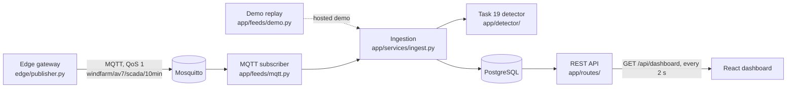

# Architecture

Readings travel from the turbine to the dashboard through five pieces. The
detector sits in the backend but has no web or database code, so the same
logic runs in the API, the tests and the evaluation.

`INGEST_MODE` picks the source: `mqtt` in Docker Compose, `demo` on the
hosted demo (no broker available; Decision 14), `none` for tests.

## Components

| Component | Code | Responsibility |
| :-- | :-- | :-- |
| Dataset builder | `data_prep/build_dataset.py` | Raw HDF5 (~7 Hz) → 10-minute statistics CSV, run once |
| Edge gateway | `edge/publisher.py` | Publish each 10-minute summary over MQTT, QoS 1, waiting for the broker's acknowledgement |
| Broker | Mosquitto 2 | Route messages; queue them for the backend while it is disconnected |
| Feeds | `backend/app/feeds/` | MQTT subscriber, or in-process replay for the hosted demo |
| Ingestion | `backend/app/services/ingest.py` | Validate, reject duplicates and out-of-order readings, run the detector, write reading + events + state in one transaction |
| Detector | `backend/app/detector/` | Reference curve (P10/P50/P90) and the streaming Task 19 detector |
| API | `backend/app/routes/` | Status, readings, events, reference curve; optional HTTP ingestion |
| Dashboard | `frontend/` | Status, power vs expectation, power curve, events, readings table |

## Data model

| Table | Holds | Notes |
| :-- | :-- | :-- |
| `scada_readings` | One row per 10-minute reading, with the detector's flag, P10/P50/P90 and energy shortfall | `timestamp` unique and indexed; `event_id` links readings to their event |
| `ice_events` | One row per confirmed event: class, start, last reading, end, readings, energy lost, mean wind | `ended_at` is null while the event is active |
| `detector_state` | One row: the detector's current run and active event as JSON | Written in the same transaction as each reading |

Timestamps are the turbine's own clock, stored without a timezone and shown
as recorded. `received_at` is when the backend processed the reading, in UTC.

## API

| Method | Path | Returns |
| :-- | :-- | :-- |
| GET | `/api/dashboard?limit=N` | Status, the last N readings and recent events in one response |
| GET | `/api/status` | Latest reading, active event, run in progress, totals, feed |
| GET | `/api/readings?limit=N` | Last N readings, oldest first |
| GET | `/api/events?limit=N` | Events, newest first |
| GET | `/api/reference-curve` | The clean-blade curve and the persistence settings |
| POST | `/api/readings` | Ingest one reading; 403 unless `ALLOW_HTTP_INGEST=true`, 409 duplicate, 422 invalid or out of order |
| GET | `/health` | Liveness check |

Interactive documentation is at `/docs` on a running backend.

## Configuration

| Variable | Default | Used for |
| :-- | :-- | :-- |
| `DATABASE_URL` | `sqlite:///./local.db` | Any `postgres://` or `postgresql://` URL is rewritten to use psycopg 3 |
| `INGEST_MODE` | `none` | `none`, `mqtt` or `demo` (`demo` deletes all readings and events on every loop) |
| `DEMO_SECONDS_PER_SAMPLE` | `2` | Wall-clock seconds between replayed readings |
| `DEMO_LIVE_FROM` | `2022-11-04T00:00:00` | Readings before this are preloaded each loop |
| `MQTT_HOST` / `MQTT_PORT` / `MQTT_TOPIC` | `localhost` / `1883` / `windfarm/av7/scada/10min` | Broker connection |
| `ALLOW_HTTP_INGEST` | `false` | Enables `POST /api/readings` |
| `FRONTEND_URL` | none | Extra origin allowed by CORS |
| `VITE_API_URL` (frontend, build time) | `http://localhost:8000` | Where the dashboard fetches from |

## Deployment

The hosted demo runs the backend container on Render (free tier, sleeps when
idle), the database on Neon (PostgreSQL) and the dashboard on Netlify. The
backend needs `DATABASE_URL`, `FRONTEND_URL` and `INGEST_MODE=demo` (the
default is `none`, because demo mode wipes the database on every loop). The frontend needs `VITE_API_URL` at build time.

## Tests and CI

`.github/workflows/ci.yml` runs on every push and pull request to `main`:

- **Backend:** 50 pytest tests covering the reference curve, detector rules, restart safety, API behaviour, duplicates, ordering and MQTT acknowledgement, run on both SQLite and PostgreSQL.
- **Evaluation:** reruns the full evaluation on the committed dataset and fails if any result differs from `evaluation/results/metrics.json`.
- **Frontend:** ESLint, Vitest unit tests and a production build, which includes type checking.
- **Docker:** builds the backend image.
