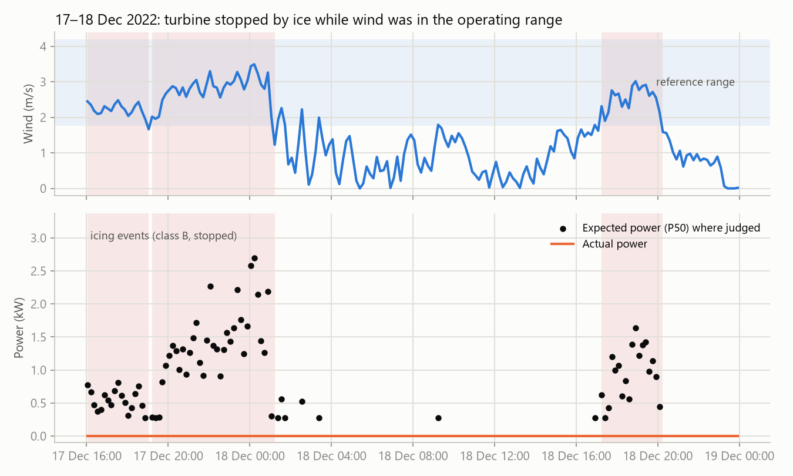
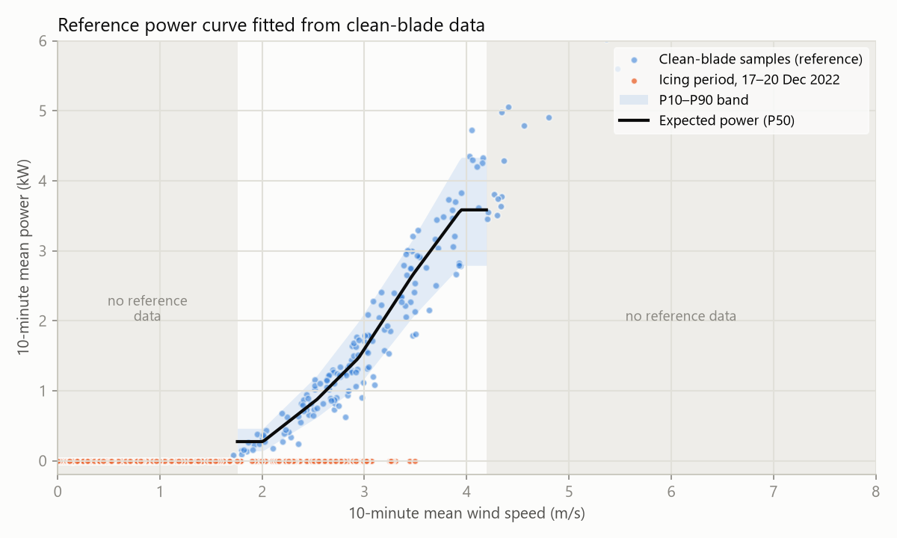

# Evaluation

The detector finds the one icing event in the public data, an hour after it
starts, and raises false events on one clean day out of eleven. A rule that
flags any zero-output reading finds the event sooner but raises twice as many
false events, spread across six days.

Everything here is produced by `evaluate.py` from the committed 10-minute
dataset. CI reruns it with `--check` and fails if any number changes.

```sh
pip install -r evaluation/requirements.txt
python evaluation/evaluate.py          # writes results/metrics.json and the figures
python evaluation/evaluate.py --check  # compares against the committed metrics.json
```

## Data

| Period | Days | 10-minute readings | Judged (inside reference range) |
| :-- | --: | --: | --: |
| Clean blades, Mar–Nov 2022 | 11 | 503 | 190 |
| Icing, 17–20 Dec 2022 | 4 | 413 | 79 |

The period labels come from the dataset's own README: 17–20 December is the
icing period, and the other days are clean-blade reference data. Ice on the
blade is visible in the dataset's photo from 19 December
([docs/images/iced-blade.jpg](../docs/images/iced-blade.jpg)).

Most readings are not judged because the reference curve only covers
1.76–4.19 m/s. Outside that range there are fewer than 10 clean samples per
0.5 m/s bin, and the detector does not extrapolate. The icing period was also
calm: 18–20 December averaged under 1.2 m/s, below the turbine's 2 m/s cut-in.

## Method

- **Leave-one-day-out for clean days.** For each clean day, the reference curve is fitted on the other ten days only, and the detector then runs over the held-out day. Any event raised there is a false event.
- **Icing period.** Scored against a curve fitted on all eleven clean days.
- **Event-level first.** There is one icing event in the data. Per-reading precision and recall would mostly measure how long that one event lasted, so the headline results are counted in events.
- **Baseline.** Raise an alarm for every reading with power below 1% of rated (70 W) and wind at or above the 2 m/s cut-in. Consecutive alarms count as one event. It needs no reference curve and no persistence rule, which makes it the bar the detector has to clear.

## Results

### Icing period

| | Task 19 detector | Zero-output rule |
| :-- | :-- | :-- |
| Detected | Yes, as class B (stopped) | Yes |
| First confirmed | 17 Dec 17:02, 60 min after the period starts | 10 min after |
| Events | 3 (the event splits when wind drops out of the reference range) | 7 |
| Judged readings inside an event | 72 of 79 | – |
| Energy lost against P50 | 12.68 kWh | – |

The detector's three events:

| Start | End | Readings | Energy lost | Mean wind |
| :-- | :-- | --: | --: | --: |
| 17 Dec 16:02 | 17 Dec 19:02 | 18 | 1.64 kWh | 2.2 m/s |
| 17 Dec 19:12 | 18 Dec 01:13 | 36 | 8.19 kWh | 2.8 m/s |
| 18 Dec 17:14 | 18 Dec 20:15 | 18 | 2.85 kWh | 2.6 m/s |



### Clean days

| Day | Readings | Judged | Detector false events | Zero-output false events |
| :-- | --: | --: | --: | --: |
| 24 Mar | 66 | 0 | 0 | 0 |
| 8 Apr | 12 | 0 | 0 | 0 |
| 9 Apr | 24 | 0 | 0 | 2 |
| 7 May | 66 | 7 | 0 | 1 |
| **20 Jun** | 77 | 59 | **6** | 4 |
| 7 Aug | 35 | 35 | 0 | 0 |
| 17 Aug | 42 | 9 | 0 | 1 |
| 3 Sep | 30 | 14 | 0 | 1 |
| 14 Oct | 113 | 32 | 0 | 3 |
| 1 Nov | 23 | 20 | 0 | 0 |
| 4 Nov | 15 | 14 | 0 | 0 |
| **Total** | 503 | 190 | **6** | **12** |

On 9 April the zero-output rule fires while the turbine is stopped in 11–17 m/s wind, mostly above its 14 m/s cut-out. The
detector marks those readings "not judged" because there is no reference data
at that wind speed.

**20 June 2022.** With the day held out, the turbine produced a median of 71%
of the reference power, with a lower rotor speed than other days at the same
wind. It had the highest turbulence of the clean days (turbulence intensity
0.25), but 1 November was nearly as turbulent (0.24) and ran normally, so
turbulence doesn't explain it. The data doesn't show the cause. Five of the
six false events are class A (reduced output), which is the correct class for
a turbine that is underperforming. It was June, so a temperature signal would
have ruled out ice.



## Limits

- **One icing event.** Too few to estimate a detection rate or a false-negative rate.
- **Only class B has met real ice.** The turbine was stopped for the entire icing period, so class B (stopped) is the path tested against real ice. Classes A and C are tested only for false alarms.
- **No temperature.** The AV-7 temperature sensor reads 81 °C in December and −1,000,000 in places. Task 19 only raises icing alarms below +1 °C; without that condition, any underperformance looks like ice. The detector applies the condition whenever a temperature is supplied.
- **Small reference.** 187 clean 10-minute samples, most between 2 and 4.5 m/s. Task 19 normally requires 36 samples per bin (a year of data); this project uses 10 and says so.

## Version 1 comparison

`legacy_comparison.py` re-implements the first version's detector (a ratio
check on ~7 Hz readings, alarm when 7 of the last 10 are below 0.1) and its
evaluation exactly. It needs the raw HDF5 files (see
[data/README.md](../data/README.md)), so it doesn't run in CI. Results are in
[results/legacy_metrics.json](results/legacy_metrics.json).

| | Precision | Recall | F1 |
| :-- | --: | --: | --: |
| Version 1, as published | 0.757 | 1.000 | 0.862 |
| "Alarm if power ≤ 0", same data | 0.771 | 1.000 | 0.871 |
| Version 1, idle readings not filtered out | 0.718 | 1.000 | 0.836 |

Why the published numbers were misleading:

- **Recall was guaranteed.** All 308,119 readings labelled "icing" had power of exactly 0.0 kW, all with turbine status 13. A detector that flags near-zero output reaches recall 1.000 by construction; the version-1 threshold sweep showed recall 1.000 at every threshold from 0.1 to 0.9, which was the sign.
- **The negatives were filtered.** Only status-10 ("generating") readings were kept from the normal-operation files, which removed the idle periods that would have been false alarms.
- **Days were counted twice.** Five normal days are byte-identical files in both source folders and were counted twice.
- **Threshold chosen on the test data.** The threshold was picked on the same data it was then scored on.
